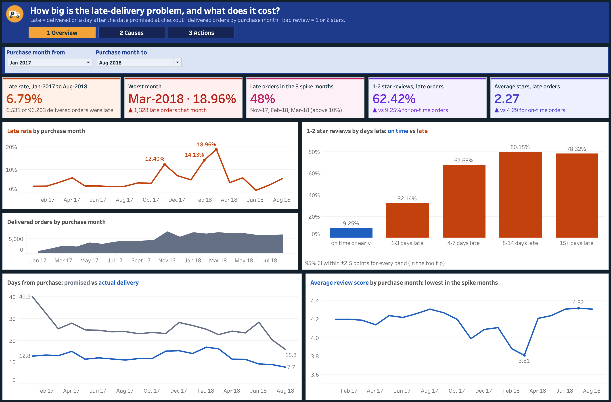
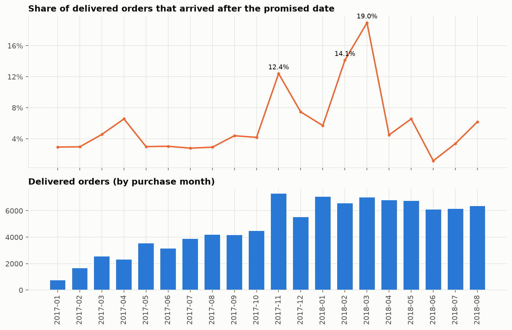
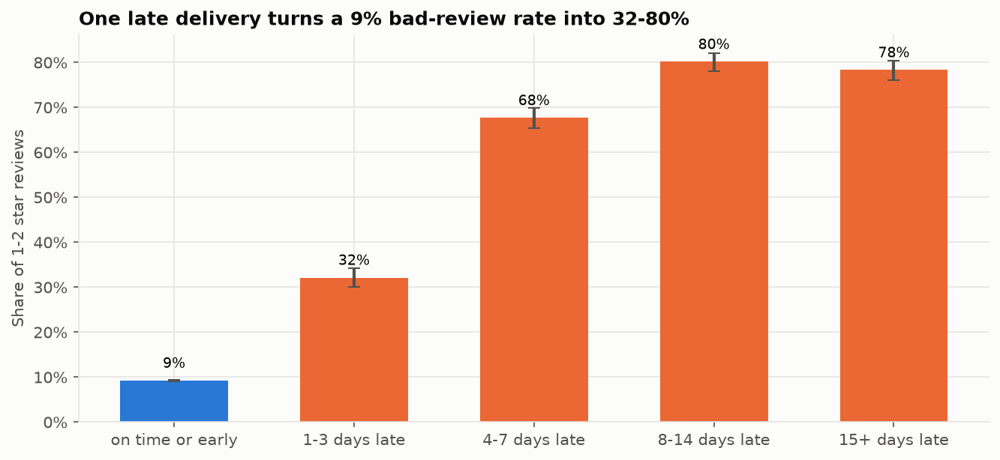
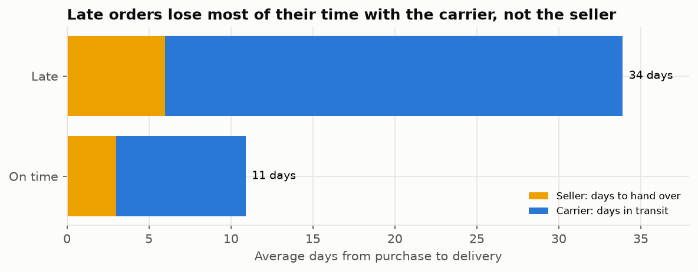
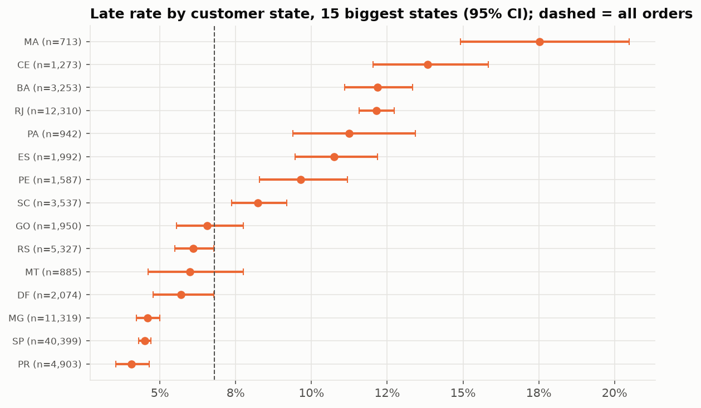
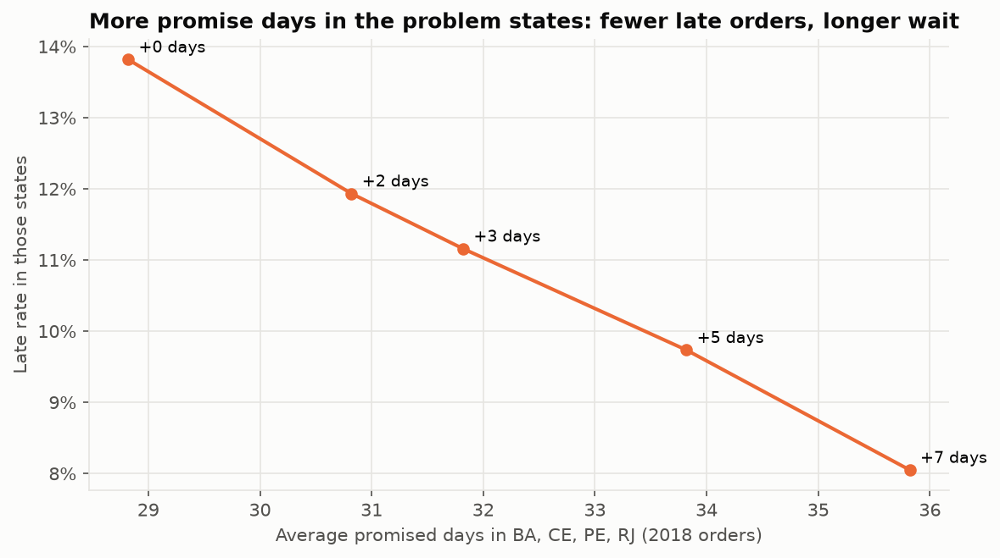
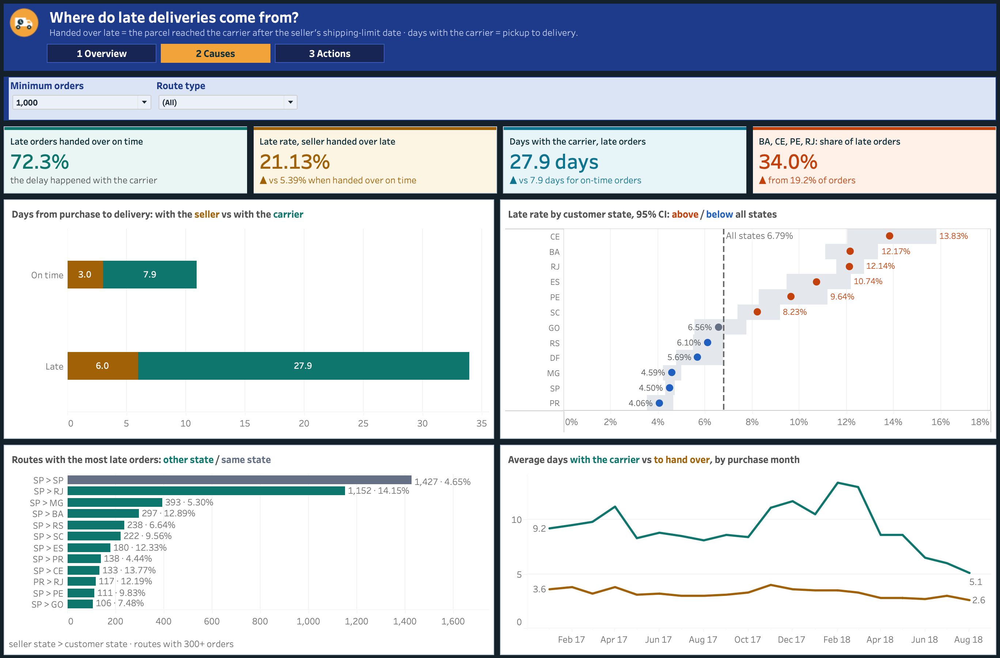
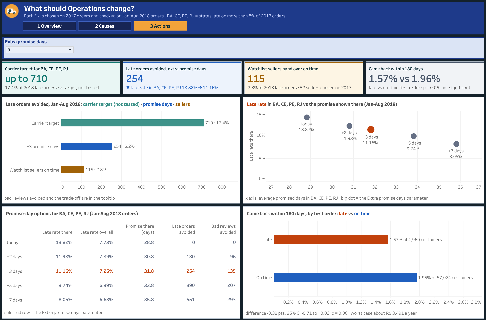
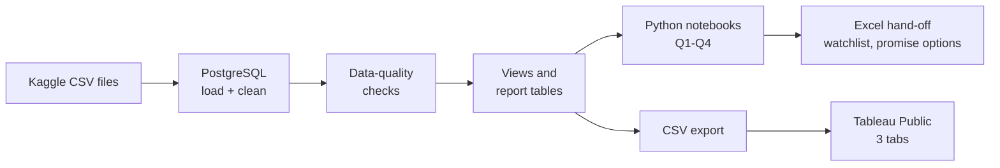

# Late Deliveries at Olist: what they cost, where they come from, and what to change


An end-to-end delivery analytics project on **real data** from **Olist**, a Brazilian e-commerce company:
measure how often orders arrive after the promised date, what that costs in reviews and repeat buying,
whether the delay comes from the seller or the carrier, and which fixes Operations should make first.

**[View the live dashboard on Tableau Public](https://public.tableau.com/app/profile/vishal.parmar7472/viz/LatedeliveriesatOlist/1Overview)**
· [Report (PDF)](reports/deck.pdf)
· [Metric definitions](docs/metric_definitions.md)
· [Notebooks](notebooks/)
· [SQL](sql/)

[](https://public.tableau.com/app/profile/vishal.parmar7472/viz/LatedeliveriesatOlist/1Overview)

## Contents

- [Business problem](#business-problem)
- [Key results](#key-results)
- [What I found](#what-i-found)
- [What I recommend](#what-i-recommend)
- [Dashboard](#dashboard)
- [Data](#data)
- [Approach](#approach)
- [Project structure](#project-structure)
- [How to run](#how-to-run)
- [Limitations](#limitations)
- [Skills used](#skills-used)
- [Contact](#contact)

## Business problem

Between Jan-2017 and Aug-2018, **6.79% of delivered orders (6,531 of 96,203)** arrived after the date promised
at checkout, and in some months the rate reached **12-19%**. Customer Experience said late orders bring 1-star
reviews; Logistics said the sellers are slow to hand over parcels. The Head of Operations asked:

| # | Question | Answered in |
|---|---|---|
| Q1 | How big is the late-delivery problem, and when does it spike? | [notebook 02](notebooks/02_late_deliveries.py) |
| Q2 | What does a late delivery cost us? | [notebook 03](notebooks/03_cost_of_lateness.py) |
| Q3 | Where does it come from: the seller or the carrier, which states and routes, why the spikes? | [notebook 04](notebooks/04_where_and_why.py) |
| Q4 | What should Operations change, and what is each change worth? | [notebook 05](notebooks/05_actions.py) |

Before any of this, [notebook 01](notebooks/01_data_quality.py) checks the data.

## Key results

| Metric | Result |
|---|---|
| Late rate, Jan-2017 to Aug-2018 | **6.79%** (6,531 of 96,203 delivered orders); worst month Mar-2018 at **18.96%** |
| 1-2 star reviews, on time vs late | **9.25% vs 62.42%**; average 4.29 vs 2.27 stars |
| Repeat buying within 180 days, after an on-time vs a late first order | 1.96% vs 1.57%, **not significant** (p = 0.06) |
| Late orders the seller handed to the carrier on time | **72.3%**: the delay happened with the carrier |
| Days with the carrier, late vs on-time orders | **27.9 vs 7.9 days** |
| BA, CE, PE and RJ (Jan-Aug 2018) | 18.1% of orders, **32.4% of late orders** |
| Late orders avoided on Jan-Aug 2018 (chosen on 2017) | carrier target **up to 710** · +3 promise days **254** · seller watchlist **115** |

## What I found

**1. Late orders spike in a few months, while the promise is already long.**
In 17 of the 20 months the late rate was between 1.2% and 7.5%. Then it reached 12.40% in Nov-2017, 14.13% in
Feb-2018 and 18.96% in Mar-2018, and those 3 months hold 48% of all late orders. The median order is promised in
24 days and delivered in 10, so the fix is not a longer promise everywhere: the problem sits in specific months
and places.



**2. A late order is a bad review, but it does not measurably reduce repeat buying.**
1-2 star reviews go from 9.25% for on-time orders to 32.14% at 1-3 days late and 80.15% at 8-14 days late.
Repeat buying is rare on Olist: 1.9% of customers come back within 180 days. After a late first order 1.57%
came back, against 1.96% after an on-time one (difference −0.38 points, 95% CI −0.71 to +0.02, p = 0.06).
I report it as not proven, worth at most about R$ 3,491 a year.



**3. Most of the delay happens with the carrier, not the seller.**
72.3% of late orders were handed over on time. Late orders spend 27.9 days with the carrier against 7.9 for
on-time ones, and 6.0 days with the seller against 3.0. A late handover does matter (21.13% of those orders
arrive late, against 5.39%), but it is the smaller part. In the spike months the days with the carrier rose
from about 8.5 to 11.1 (Nov-2017) and 13.4 (Feb-2018), while the days to hand over stayed at 3-4.



**4. The same states are late every year.**
Orders to another state are late 8.1% of the time, against 4.5% inside the same state. BA, CE, PE and RJ are
above the national rate in both years (CE 13.83%, 95% CI 12.04-15.83%), and the route SP > RJ alone had 1,152
late orders.



## What I recommend

Each action was **chosen on 2017 orders and checked on Jan-Aug 2018 orders**, so no fix is measured on the
data used to pick it.

| # | Action | Late orders avoided, Jan-Aug 2018 | Bad reviews avoided | Trade-off |
|---|---|---|---|---|
| 1 | Logistics: agree a carrier target for BA, CE, PE and RJ (the rest-of-country late rate) | **up to 710** (17.4%) | 378 | A target, not a tested change: the data has no carrier name |
| 2 | Add 3 days to the promised date in BA, CE, PE and RJ only | **254** (6.2%) | 135 | Promise 31.8 instead of 28.8 days there; test on a share of orders first |
| 3 | Seller Ops: work with the watchlist sellers on handover | **115** (2.8%) | 61 | Seller Ops time with 52 sellers (chosen on 2017) |

The promise-day options (0, +2, +3, +5, +7 days) show the cost of each choice: +3 days takes the late rate in the
four states from 13.82% to 11.16%, +5 days to 9.74%.



The current seller watchlist (89 sellers with 30+ orders and 20%+ late handovers, 15% of all late orders), the
promise-day options and the impact table go to Operations as an Excel hand-off. The watchlist has seller IDs,
so it stays out of this repository and out of Tableau Public. The full story for the Head of Operations, with
next steps for the first 90 days, is in the [report deck](reports/deck.pdf).

## Dashboard

Three tabs on Tableau Public. Buttons at the top move between the tabs.

| Tab | For | What it shows |
|---|---|---|
| [1 Overview](https://public.tableau.com/app/profile/vishal.parmar7472/viz/LatedeliveriesatOlist/1Overview) | Head of Operations | KPI tiles, late rate and delivered orders by month, 1-2 star reviews by days late, promised vs actual delivery days, review score by month. Filter: purchase month from / to |
| [2 Causes](https://public.tableau.com/app/profile/vishal.parmar7472/viz/LatedeliveriesatOlist/2Causes) | Logistics, Seller Ops | Days with the seller vs with the carrier, late rate by state with 95% CIs, routes with the most late orders, the spike months. Filters: minimum orders per state, route type |
| [3 Actions](https://public.tableau.com/app/profile/vishal.parmar7472/viz/LatedeliveriesatOlist/3Actions) | Operations | Late orders avoided by each action, the promise trade-off and its options table, repeat buying after a late first order. Parameter: extra promise days |

| Causes | Actions |
|---|---|
|  |  |

## Data

**Real, public data:** the [Brazilian E-Commerce Public Dataset by Olist](https://www.kaggle.com/datasets/olistbr/brazilian-ecommerce)
on Kaggle (CC BY-NC-SA 4.0): 99,441 anonymised orders placed between Sep-2016 and Oct-2018. I am not affiliated
with Olist. Amounts are in R$ (Brazilian real), as in the data.

| Table | Rows | Used for |
|---|---|---|
| orders | 99,441 | status, purchase / carrier / delivery timestamps, promised date |
| order_items | 112,650 | seller of each order, handover deadline, price and freight |
| order_reviews | 99,224 | review score after delivery |
| customers | 99,441 | customer state, the person behind each order (`customer_unique_id`) |
| sellers | 3,095 | seller state |
| products, category translation | 32,951 · 71 | product categories in English |

Payments and geolocation are real too, but no question here needs them, so they are not loaded. The analysis
uses orders purchased Jan-2017 to Aug-2018; the months before and after have too few orders to compare.

The raw files have problems that matter for this analysis. [Notebook 01](notebooks/01_data_quality.py) finds
them, and [`sql/02_clean.sql`](sql/02_clean.sql) and the views deal with each one:

1. 2 product categories are missing from the English translation file, and 610 products have no category
2. 189 orders have impossible timestamps (handed to the carrier before the purchase, or delivered before the
   pickup): they stay in the late rate, but their handover and carrier times are not used
3. 547 orders have 2 or more reviews (814 review ids are reused): the latest answer is kept
4. 8 delivered orders have no delivery date and 6 canceled orders have one: both are left out
5. `customer_id` is new for every order, so repeat buying uses `customer_unique_id` (one per person)
6. 906 "second orders" came within a day of the first one: that is one shopping trip, not a return visit

Data-quality checks ([`src/dq_checks.py`](src/dq_checks.py)) must pass before any number is used. The data files
are not in this repository (licence and size); download them from Kaggle.

## Approach



| Step | Method |
|---|---|
| Q1: how big, when | Late = delivered on a calendar day after the promised date; late rate by purchase month; days-late bands; promised vs actual delivery days |
| Q2: what it costs | 1-2 star share by days late with Wilson 95% confidence intervals; repeat buying within 180 days with a two-proportion test and a Newcombe interval; a worst-case R$ value |
| Q3: where it comes from | Each delivery split into seller handover and carrier transit; late rate by state and by route with 95% CIs; spike months compared on both parts |
| Q4: what to change | Out-of-time test: problem states and the seller watchlist chosen on 2017 orders, measured on Jan-Aug 2018; promise-day options; impact table with late orders and bad reviews avoided |

Every metric is defined in [docs/metric_definitions.md](docs/metric_definitions.md): what is counted, out of
what, and where the logic lives.

## Project structure

```
olist-delivery-analytics/
├── config/settings.yaml          # business inputs: analysis months, watchlist and promise rules
├── sql/
│   ├── 01_create_tables.sql      # one table per file, plus load and data-quality logs
│   ├── 02_clean.sql              # the data fixes
│   ├── 03_views.sql              # one row per delivered order: late flag, handover and carrier days, route
│   └── 04_reports.sql            # monthly KPIs, days-late bands, states and routes with 95% CIs
├── src/
│   ├── load_data.py              # load data/raw into PostgreSQL, then run the SQL files
│   ├── dq_checks.py              # data-quality checks
│   ├── export.py                 # CSVs for Tableau, Excel hand-off for Operations
│   └── config.py, db.py, style.py
├── notebooks/                    # 01 data quality, 02-05 one per business question
├── reports/
│   ├── deck.pdf                  # final report: findings, recommendations and next steps, 15 slides
│   └── figures/                  # charts used in this README
├── dashboards/                   # Tableau workbook and tab screenshots
└── docs/metric_definitions.md
```

## How to run

You need Python 3.12+, [uv](https://docs.astral.sh/uv/) and PostgreSQL. Download the dataset from Kaggle and
unzip the files into `data/raw/` first.

```bash
uv sync                                  # install the Python packages
createdb olist                           # create the PostgreSQL database
cp .env.example .env                     # add your database user name
uv run python -m src.load_data           # load data/raw, clean it, build the views and report tables
uv run python -m src.dq_checks           # every ERROR check must show 0
# notebooks 01-05: run cell by cell in VS Code (they are .py files with # %% cells)
uv run python -m src.export              # CSVs for Tableau + the Excel hand-off
```

The data is historical, so there is no monthly refresh. If the notebooks and the export are run again, the CSVs
keep their names: refresh the extracts in Tableau and publish again.

## Limitations

- The data has no carrier name, so the carrier action is sized as a target, not tested as a change.
- "Bad reviews avoided" assumes an avoided late order gets the on-time review rate.
- A longer promise can lose buyers at checkout, and the data has no checkout or browsing data to measure it, so
  the +3 days should be tested on a share of orders first.
- Repeat buying is rare (1.9%), so a small real effect of lateness could be missed; the 95% interval still allows
  a difference of up to −0.71 points.
- The route uses the seller of the first item; 1.3% of orders have items from 2 or more sellers.

## Skills used

**SQL:** table design, data cleaning, views, window functions, Wilson confidence intervals ·
**Python:** pandas, statsmodels, matplotlib · **Statistics:** confidence intervals, two-proportion test,
out-of-time testing · **Operations analytics:** delivery SLAs, seller vs carrier split, route analysis,
promise-date trade-offs · **Reporting:** Tableau Public, Excel hand-off

---

## Contact

**Vishal Parmar** · Data Analyst\
[LinkedIn](https://www.linkedin.com/in/vishalp1726) · [vishalp4607@gmail.com](mailto:vishalp4607@gmail.com)
